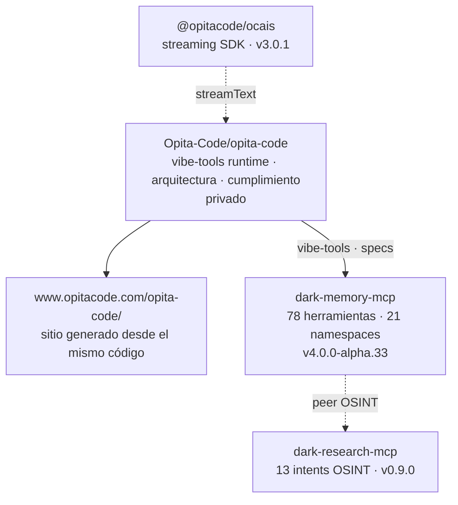

# Opita Code

> **Software práctico para negocios reales.** Construido desde Colombia con identidad local y ambición global.
> **Practical software for real businesses.** Built from Colombia with local identity and global ambition.

**Estado: 2026-11-12.** Opita Code es una empresa con producto cerrado. El camino
abierto —el kernel MCP, el SDK de streaming y el OSINT— se publica; el taller, no.

## La promesa

> **Opita Code es el lugar donde tu memoria te pertenece.**
>
> La memoria de una persona —su contexto, sus herramientas, lo que ha aprendido de ella— suele vivir en el sitio equivocado: en una sesión que se cierra, en una cuenta que no es suya, o en un perfil que la reduce a un segmento. Opita Code da a cada persona una memoria propia, fiel e incorruptible, que viaja con ella y que sus herramientas pueden usar sin que nadie más la toque.
>
> Legal, profesional y anónima: las tres son tuyas, y ninguna se mezcla con las otras.
>
> Y no hace falta saber programar para tenerla.

Cada persona tiene tres identidades —**legal** (KYC verificado), **empresa** (hasta tres) y **perfil anónimo** (uno, con apodo inmutable de un pool cerrado)— y una regla dura: el contexto inyectado a las herramientas nunca cruza de una identidad a otra.

## Lo que pasó con los productos

Los productos que estaban publicados se retiraron de producción en **julio de 2026**. La causa fue el decomisionamiento de un pool de Cognito sin acuerdo previo, que el operador consideró un ataque a la empresa: en vez de reconstruir a medias, retiró todo.

El código no se perdió: sigue en los repositorios. Lo que se perdió fue el despliegue. Si se vuelve a publicar, y con qué infraestructura de identidad, está por decidir.

De ahí en adelante el trabajo se movió al repositorio: primero a piezas privadas (identidad, reputación, un juego, un runtime privado), y desde el 22 de octubre al repositorio canónico que ves aquí, que es la segunda fundación del proyecto: no el marketplace, sino el runtime que lo sostiene.

## Qué se está construyendo

`opitacode.com` es el destino, y hoy también el nombre del proyecto en construcción:

- **vibe-studio** es la plataforma: el lugar donde alguien construye sus herramientas sin saber programar.
- **opitacode.com** es el mercado de esas herramientas. Todo lo que se publica es gratis y exportable; el valor de la plataforma está en la infraestructura, el compañero, la memoria, la identidad y el juez. Tres apps propias quedan siempre fijadas arriba: vibe studio, opita trabajos, opita market.
- **vibe-tools** es el runtime: herramientas componibles, local-first, serverless-first, con un formato de paquete portable (`.opitpack`).

El repositorio canónico es `Opita-Code/opita-code`, y es **privado**. Ahí vive el runtime, la arquitectura y el documento de cumplimiento. Lo que se publica es lo que produce: el sitio se genera desde el mismo archivo que genera el README y el STATUS, de modo que lo que se publica no se escribe a mano: [www.opitacode.com/opita-code](https://www.opitacode.com/opita-code/).

## El kernel: dark-memory-mcp + Vibe-Flow

El kernel es un par: **dark-memory-mcp**, el servidor MCP que entrega gobernanza, memoria, research y vibe-flow como un set unificado de herramientas; y **Vibe-Flow**, la forma de trabajar: *spec → artefacto → drift → reconciliación → publish*.

| Componente | Estado real (2026-11-12) |
| --- | --- |
| [`dark-memory-mcp`](https://github.com/Opita-Code/dark-memory-mcp) | **v4.0.0-alpha.33** (11-2026). 78 herramientas canónicas en 21 namespaces, schema v32. **Pre-release.** Policy Gateway y plano de datos de memoria. |
| [`dark-research-mcp`](https://github.com/Opita-Code/dark-research-mcp) | **v0.9.0** (08-2026). 13 intents OSINT. Es *peer*, no gateway. Los nombres legacy (`dark_research_*`, `dark_ssd_*`) son shims que delegan en `dark_memory_*`. MIT. |
| `@opitacode/ocais` | **v3.0.1** en npm (07-2026). SDK de streaming para AWS Lambda, cero dependencias. MIT. |
| `dark-copilot` | **v3.4.9**. Browser real con Chrome por CDP, con huella digital corregida y cadencia humanizada. Vive fuera de la organización pública. |

### Cómo se produce cada cambio

```
  spec  →  artefacto  →  drift  →  reconciliación  →  publish
   │          │            │            │                │
  vibe-spec  artefacto    juez       spec ↔ artefacto   veredicto
  (OpenSpec  publicado   drift_judge  documentada      persistido
   vive en el runtime                   con el juez
   privado)
```

Cada artefacto se publica bajo una spec, y un juez LLM lo compara contra esa spec: el veredicto es `aligned`, `drift_detected` o `needs_human`. Con `drift_detected` se corrige y se vuelve a publicar; con `needs_human` el trabajo se detiene y el caso sube a la persona. **LLM-as-judge, no LLM-as-author.**

### El plan, por loops

| Loop | Qué entrega | Estado |
| --- | --- | --- |
| L0 | Fundación: los contratos | cerrado |
| L1 | Runtime: la caja de cada herramienta (sandbox T0/T1/T2) | cerrado |
| L2 | Composición: encadenar sin equivocarse | cerrado |
| L3 | Boundary MEMORY: la memoria es tuya y de nadie más | cerrado |
| L4 | Identidad: un stub, y después tres identidades | cerrado |
| L5 | Juez: el pipeline, y el uso medido del proveedor | cerrado |
| L6 | Marketplace: publicar, con licencia y con pin | cerrado |
| L7 | Reputación: el sello del juez, visible | cerrado |
| L8 | SOTA | siguiente |

### La evidencia, medida

| Medida | Resultado |
| --- | --- |
| Tests | 655 de 655, 0 fallos, 0 saltados |
| Mutantes | 379 de 379 (100 %, 68 paquetes; umbral 80 %) |
| Unidades juzgables | 235, y 0 exceden los 4096 B |
| Gates de loop | 8 loops cerrados |
| Veredicto del juez | 86 documentos con veredicto vigente, `aligned` entre 0.96 y 1.00, MiniMax-M3 |

Y la parte que importa: **esos números no están escritos a mano.** El repositorio trae un verificador (`npm run verificar-estado`) que mide de verdad lo que el repositorio afirma de sí mismo y falla si un número no cuadra. Por eso lo que se publica arriba no puede envejecer en silencio.

```bash
cd vibe-tools
npm install
npm run check              # contenido, presupuesto, tests y mutación
npm run verificar-estado   # el estado publicado, contrastado contra la realidad
```

## El ecosistema

Qué hay en la organización, en qué estado y con qué fecha del último cambio. Sin adornos: un repositorio pausado es un repositorio pausado.



### Qué es público, y por qué

La regla es una sola: **se publica lo que alguien de fuera tiene una razón mecánica
para instalar o para leer.** Un SDK que se instala, un kernel que se documenta. El
producto no se publica.

| Repositorio | Qué es | Estado |
| --- | --- | --- |
| [`dark-memory-mcp`](https://github.com/Opita-Code/dark-memory-mcp) | Kernel MCP: gobernanza, memoria, research y vibe-flow | **activo** · v4.0.0-alpha.33 · pre-release |
| [`dark-research-mcp`](https://github.com/Opita-Code/dark-research-mcp) | Backends OSINT, *peer* del kernel | v0.9.0 · MIT |
| [`ocais`](https://github.com/Opita-Code/ocais) | SDK de streaming para AWS Lambda | v3.0.1 (npm) · MIT |

### El repositorio canónico es privado, y su superficie no

`opita-code` —el runtime, la arquitectura y el documento de cumplimiento— es
privado. Lo que se publica es **lo que ese repositorio produce**: las mediciones,
el estado, y el sitio.

El sitio está en [www.opitacode.com/opita-code/](https://www.opitacode.com/opita-code/),
y se genera desde el mismo archivo que genera el README y el STATUS, de modo que lo
que se publica no se escribe a mano. El repositorio canónico es el taller; el
sitio es la conclusión medida.

La diferencia no es de estilo: es que el sitio se puede auditar. Cada número que
aparece ahí está medido por un verificador que compara lo que el repositorio
afirma de sí mismo contra la realidad, y falla si no cuadra.

### Qué es privado

`opita-os` (SSOT, OpenSpec, brand engine, vault cifrado, SSO) y `opita-market`
(marketplace multi-vertical) son los dos que la documentación pública ya nombra. Los
demás siguen privados y no se nombran aquí: el repositorio canónico, identidad y
reputación, la aplicación de identidad, la extensión de escritorio, las plantillas
de marketplace, el acortador de enlaces, las utilidades internas de mercado y el
pipeline de selección de personal.

Los repositorios que se cerraron en noviembre de 2026 —la landing corporativa, las
plantillas de storefront, el IDE de vibe-coding, el portfolio del developer, el
monumento digital, y los dos repositorios congelados de runtime— también son privados,
y sus nombres no se nombran aquí.

## Lo que está abierto

- Si el documento legal de cumplimiento (Ley 1581 de 2012, Habeas Data) se hace público.
- El eje del corte de identidades: por creencia, y no por edad, rol o cohorte.
- Cuál se degrada si hay que elegir: el anonimato o el antifraude.
- El sexto consentimiento, en contexto de organización, y su techo de falsos positivos.
- Los bindings reales de Pyodide, WebContainers y Firecracker: la política del sandbox está verificada, el runtime todavía no está ejercitado.

Mientras eso no cierre, la regla se mantiene: no se publica nada que afirme ejecutar con red en T1 o T2.

## Conéctate

| Canal | Enlace |
| --- | --- |
| Sitio | [www.opitacode.com/opita-code](https://www.opitacode.com/opita-code/) |
| Repositorio | privado · el canónico es `Opita-Code/opita-code` |
| Founder | [Nicolás Urrutia](https://www.linkedin.com/in/nicourrutia98/) |
| Sede | Neiva, Huila, Colombia 🇨🇴 |
| WhatsApp | [wa.me/573126126085](https://wa.me/573126126085) |

<p align="center">
  <br>
  © 2026 Opita Code · Juan Nicolás Urrutia Salcedo
  <br>
  <i>Hecho con orgullo colombiano 🇨🇴 · Made in Colombia</i>
  <br>
  <sub>Última revisión del README: 2026-11-12 — contrastado contra la API de GitHub (visibilidad, estado y última fecha de cada repositorio), contra npm (las versiones publicadas de los paquetes de la organización) y contra el estado medido del repositorio canónico.</sub>
</p>
