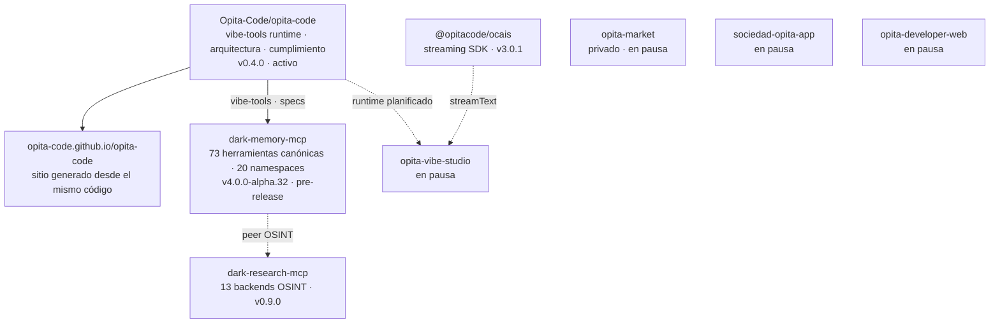

# Opita Code

> **Software práctico para negocios reales.** Construido desde Colombia con identidad local y ambición global.
> **Practical software for real businesses.** Built from Colombia with local identity and global ambition.

**Estado: 2026-10-25.** Opita Code está en construcción y **no tiene nada desplegado en producción**. Lo que existe hoy es el repositorio canónico, el sitio que se genera desde el mismo código, y el kernel que lo gobierna.

> **State: 2026-10-25.** Opita Code is under construction and **has nothing deployed in production**. What exists today is the canonical repository, the site generated from that same code, and the kernel that governs it. In one line: the runtime behind `opitacode.com` is being rebuilt around a memory that belongs to the person — every number measured, every change judged before it ships.

## La promesa

> **Opita Code es el lugar donde tu memoria te pertenece.**
>
> La memoria de una persona —su contexto, sus herramientas, lo que ha aprendido de ella— suele vivir en el sitio equivocado: en una sesión que se cierra, en una cuenta que no es suya, o en un perfil que la reduce a un segmento. Opita Code da a cada persona una memoria propia, fiel e incorruptible, que viaja con ella y que sus herramientas pueden usar sin que nadie más la toque.
>
> Legal, profesional y anónima: las tres son tuyas, y ninguna se mezcla con las otras.
>
> Y no hace falta saber programar para tenerla.

Cada persona tiene tres identidades —**legal** (KYC verificado), **empresa** (hasta tres) y **perfil anónimo** (uno, con apodo inmutable de un pool cerrado)— y una regla dura: el contexto inyectado a las herramientas nunca cruza de una identidad a otra.

## Lo que pasó con los productos

Los productos que estaban publicados se retiraron de producción en **julio de 2026**. La causa fue el decomisionamiento de un pool de Cognito sin acuerdo previo, que el operador consideró un ataque a la empresa: en vez de reconstruir a medias, retiró todo.

El código no se perdió: sigue en los repositorios. Lo que se perdió fue el despliegue. Si se vuelve a publicar, y con qué infraestructura de identidad, está por decidir.

De ahí en adelante el trabajo se movió al repositorio: primero a piezas privadas (identidad, reputation, un juego, un runtime privado), y desde el 22 de octubre al repositorio canónico que ves aquí, que es la segunda fundación del proyecto: no el marketplace, sino el runtime que lo sostiene.

## Qué se está construyendo

`opitacode.com` es el destino, y hoy también el nombre del proyecto en construcción:

- **vibe-studio** es la plataforma: el lugar donde alguien construye sus herramientas sin saber programar.
- **opitacode.com** es el mercado de esas herramientas. Todo lo que se publica es gratis y exportable; el valor de la plataforma está en la infraestructura, el compañero, la memoria, la identidad y el juez. Tres apps propias quedan siempre fijadas arriba: vibe studio, opita trabajos, opita market.
- **vibe-tools** es el runtime: herramientas componibles, local-first, serverless-first, con un formato de paquete portable (`.opitpack`).

El repositorio canónico es [`Opita-Code/opita-code`](https://github.com/Opita-Code/opita-code) (v0.4.0, 2026-10-25). Ahí vive el runtime, la arquitectura y el documento de cumplimiento. El sitio público se genera desde el mismo archivo que genera el README y el STATUS, de modo que lo que se publica no se escribe a mano: [opita-code.github.io/opita-code](https://opita-code.github.io/opita-code/).

## El kernel: dark-memory-mcp + Vibe-Flow

El kernel es un par: **dark-memory-mcp**, el servidor MCP que entrega gobernanza, memoria, research y vibe-flow como un set unificado de herramientas; y **Vibe-Flow**, la forma de trabajar: *spec → artefacto → drift → reconciliación → publish*.

| Componente | Estado real (2026-10-25) |
| --- | --- |
| [`dark-memory-mcp`](https://github.com/Opita-Code/dark-memory-mcp) | **v4.0.0-alpha.32** (15-10-2026). 73 herramientas canónicas + 3 adicionales, 20 namespaces, schema v32. **Pre-release.** Policy Gateway y plano de datos de memoria. El binario que corre en el harness es alpha.31 (commit `16215c7`). |
| [`dark-research-mcp`](https://github.com/Opita-Code/dark-research-mcp) | **v0.9.0** (10-08-2026). 13 backends OSINT. Es *peer*, no gateway. Los nombres legacy (`dark_research_*`, `dark_ssd_*`) son shims que delegan a `dark_memory_*`. MIT. |
| `@opitacode/ocais` | **v3.0.1** en npm (23-07-2026). SDK de streaming para AWS Lambda, cero dependencias. MIT. |
| `dark-copilot` | **v3.4.9**. Browser real con Chrome por CDP, con huella digital corregida y cadencia humanizada. Vive fuera de la organización pública. |

### Cómo se produce cada cambio

```
 spec  →  artefacto  →  drift  →  reconciliación  →  publish
  │          │            │            │                │
 vibe-spec  artefacto    juez       spec ↔ artefacto   veredicto
 (OpenSpec  publicado   drift_judge  documentada      persistido
  vive en el runtime                   con el juez
  privado)
```

Cada artefacto se publica bajo una spec, y un juez LLM lo compara contra esa spec: el veredicto es `aligned`, `drift_detected` o `needs_human`. Con `drift_detected` se corrige y se vuelve a publicar; con `needs_human` el trabajo se detiene y el caso sube a la persona. **LLM-as-judge, no LLM-as-author.**

### El plan, por loops

| Loop | Qué entrega | Estado |
| --- | --- | --- |
| L0 | Fundación: los contratos | cerrado |
| L1 | Runtime: la caja de cada herramienta (sandbox T0/T1/T2) | cerrado |
| L2 | Composición: encadenar sin equivocarse | cerrado |
| L3 | Boundary MEMORY: la memoria es tuya y de nadie más | cerrado |
| L4 | Identidad: un stub, y después tres identidades | siguiente |
| L5 | Juez | planificado |
| L6 | Marketplace | planificado |
| L7 | Reputación | planificado |
| L8 | SOTA | planificado |
| L9 | Escala | planificado |

### La evidencia, medida

| Medida | Resultado |
| --- | --- |
| Tests | 282 de 282, 0 fallos |
| Mutantes | 142 de 142 (100 %, 28 paquetes; umbral 80 %) |
| Unidades juzgables | 107, y 0 exceden los 4096 B |
| Gates de loop | 4 loops cerrados |
| Veredicto del juez | 10 de 10 documentos de L3 en `aligned`, confidence 1.0000, `entailment`, MiniMax-M3 |

Y la parte que importa: **esos números no están escritos a mano.** El repositorio trae un verificador (`npm run verificar-estado`) que mide de verdad lo que el repositorio afirma de sí mismo y falla si un número no cuadra. Por eso lo que se publica arriba no puede envejecer en silencio.

```bash
cd vibe-tools
npm install
npm run check              # contenido, presupuesto, tests y mutación
npm run verificar-estado   # el estado publicado, contrastado contra la realidad
```

## El ecosistema

Qué hay en la organización, en qué estado y con qué fecha del último cambio. Sin adornos: un repositorio pausado es un repositorio pausado.



### Repositorios públicos

| Repositorio | Qué es | Estado | Último cambio |
| --- | --- | --- | --- |
| [`opita-code`](https://github.com/Opita-Code/opita-code) | Runtime vibe-tools, arquitectura y cumplimiento | **activo** · v0.4.0 | 2026-10-25 |
| [`opita-market-storefront-templates`](https://github.com/Opita-Code/opita-market-storefront-templates) | Monorepo OCAIS: backend de referencia + SDK de integración + submodules de frontend. Primer tenant: Pasiones Boutique Sensual | **activo** · prototipo | 2026-10-19 |
| [`dark-memory-mcp`](https://github.com/Opita-Code/dark-memory-mcp) | Kernel MCP | **activo** · pre-release | 2026-10-17 |
| [`dark-research-mcp`](https://github.com/Opita-Code/dark-research-mcp) | Backends OSINT | v0.9.0 | 2026-08-08 |
| [`ocais`](https://github.com/Opita-Code/ocais) | SDK de streaming para AWS Lambda | v3.0.1 (npm) | 2026-07-28 |
| [`opita-vibe-studio`](https://github.com/Opita-Code/opita-vibe-studio) | IDE de vibe-coding en español | en pausa | 2026-08-10 |
| [`www.opitacode.com`](https://github.com/Opita-Code/www.opitacode.com) | Landing corporativa | en pausa | 2026-08-04 |
| [`sociedad-opita-app`](https://github.com/Opita-Code/sociedad-opita-app) | Monumento digital del opita (Tello, Huila) | en pausa | 2026-07-28 |
| [`opita-developer-web`](https://github.com/Opita-Code/opita-developer-web) | Portfolio del Opita Developer | en pausa | 2026-07-28 |

### Repositorios privados

`opita-market` (marketplace multi-vertical), `opita-trabajos`, `vibe-studio-desktop` (Wails v3 + Go + React), `opita-os` (SSOT, OpenSpec, brand engine, vault cifrado, SSO), `opita-os-engine`, `opita-account-ui`, `opita-pixel`, `opita-links`, `opita-market-templates`, `opita-scout`, `opita-sync`, `opita-go`, `vibe-landing`, `career-ops-pipeline`, `pi`.

### Repositorios archivados

`opita-runtime` y `opita-sync-framework` (públicos, congelados como referencia; su lógica migró al runtime privado `opita-os`), más `opitacode-workspace`, `dev.opitacode.com` y `v0` (privados).

## Lo que está abierto

- Si el documento legal de cumplimiento (Ley 1581 de 2012, Habeas Data) se hace público.
- El eje del corte de identidades: por creencia, y no por edad, rol o cohorte.
- Cuál se degrada si hay que elegir: el anonimato o el antifraude.
- El sexto consentimiento, en contexto de organización, y su techo de falsos positivos.
- Los bindings reales de Pyodide, WebContainers y Firecracker: la política del sandbox está verificada, el runtime todavía no está ejercitado.

Mientras eso no cierre, la regla se mantiene: no se publica nada que afirme ejecutar con red en T1 o T2.

## Conéctate

| Canal | Enlace |
| --- | --- |
| Sitio | [opita-code.github.io/opita-code](https://opita-code.github.io/opita-code/) |
| Repositorio | [github.com/Opita-Code/opita-code](https://github.com/Opita-Code/opita-code) |
| Founder | [Nicolás Urrutia](https://www.linkedin.com/in/nicourrutia98/) |
| Sede | Neiva, Huila, Colombia 🇨🇴 |
| WhatsApp | [wa.me/573126126085](https://wa.me/573126126085) |

<p align="center">
  <br>
  © 2026 Opita Code · Juan Nicolás Urrutia Salcedo
  <br>
  <i>Hecho con orgullo colombiano 🇨🇴 · Made in Colombia</i>
  <br>
  <sub>Última revisión del README: 2026-10-25 — contrastado contra la API de GitHub (estado y última fecha de cada repositorio), contra DNS (lo único vivo es el sitio en GitHub Pages: el ápex de opitacode.com no tiene registro A ni AAAA, y sus subdominios no resuelven) y contra el estado medido del repositorio canónico v0.4.0.</sub>
</p>

